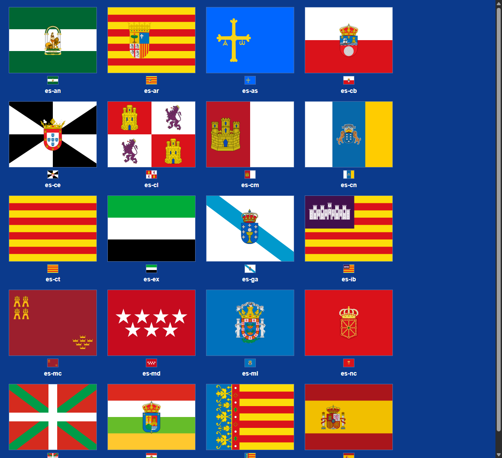

# Recursos para el streaming del Campeonato de España

Archivos para la retransmisión del Campeonato de España de speedcubing 2026 (Barakaldo, 5-7 de diciembre),
hecha con el paquete gráfico de la WCA en Singular.live. Todo se enlaza desde Singular con la URL "raw"
de GitHub:

```
https://raw.githubusercontent.com/ruben-lopez-dejuan/recursos-streaming-nacional/main/<ruta del archivo>
```

## Qué hay

| Ruta | Qué es | Dónde se usa |
|---|---|---|
| `es-*.svg`, `es.svg` | Banderas de las comunidades y ciudades autónomas, en 4:3 | Copa de España: NationsCup y Bracket |
| `logos/` | Logos para fondo oscuro, recortados sin márgenes | Pantallas de logos, Global Data |
| `logos/originales/` | Todas las versiones originales de los logos del Campeonato, la AES y la WCA | Por si hace falta otra versión |
| `competitor_facts.json` | Datos curiosos de cada competidor, por WCA ID | Global Data → Player Card Data → Fact URL |
| `docs/banderas.png` | Vista previa de las banderas | Este README |

### Logos

| Archivo | Logo |
|---|---|
| `campeonato-espana-2026*.svg` | Campeonato de España 2026, en varias versiones (grande, horizontal, vertical, condensado, solo símbolo) |
| `aes-horizontal.png`, `aes-vertical.png` | Asociación Española de Speedcubing |
| `euskalcubing-horizontal.svg` | Euskalcubing, en color |
| `barakaldo-horizontal.png`, `barakaldo-vertical.png` | Barakaldo Ciudad·Hiria, versión para fondo oscuro de su manual de identidad |
| `wca-horizontal.svg`, `wca-simbolo.svg` | World Cube Association |

## Banderas



El campo **Team Flag** de NationsCup (y la columna Flag de la hoja del Bracket) no admite URLs: el gráfico construye
`https://raw.githubusercontent.com/wca-major-championships-team/graphics_package_resources/refs/heads/main/flags/4x3/<código>.svg`.
Con siete `../` se sube a la raíz de `raw.githubusercontent.com` y se puede apuntar a este repo. Por eso las
banderas están en la raíz y no en una carpeta. Se escribe sin `.svg`:

```
../../../../../../../ruben-lopez-dejuan/recursos-streaming-nacional/main/es-md
```

| Comunidad | Código |
|---|---|
| Andalucía | `es-an` |
| Aragón | `es-ar` |
| Asturias | `es-as` |
| Illes Balears | `es-ib` |
| Canarias | `es-cn` |
| Cantabria | `es-cb` |
| Castilla y León | `es-cl` |
| Castilla-La Mancha | `es-cm` |
| Cataluña | `es-ct` |
| Extremadura | `es-ex` |
| Galicia | `es-ga` |
| La Rioja | `es-ri` |
| Comunidad de Madrid | `es-md` |
| Región de Murcia | `es-mc` |
| Navarra | `es-nc` |
| País Vasco | `es-pv` |
| Comunitat Valenciana | `es-vc` |
| Ceuta | `es-ce` |
| Melilla | `es-ml` |
| España | `es` |

Van en 4:3 (640×480) porque el gráfico las estira a esa proporción; en 3:2 salen deformadas.

- Origen: Wikimedia Commons; `es-ct`, `es-ga`, `es-pv` y `es` de [lipis/flag-icons](https://github.com/lipis/flag-icons).
- De 3:2 a 4:3 se recorta un 5,5 % por cada lado. En Aragón, Baleares y Comunitat Valenciana solo por el lado
  del vuelo, para no cortar el cantón o el escudo. Murcia va entera, con relleno granate (#9c1f2d) arriba y abajo.
- Cantabria y Extremadura, sin escudo (se ven mejor pequeñas). La Rioja, con escudo (no hay otra en Commons).

### Atribución

| Archivo | Licencia |
|---|---|
| es-an, es-ce | CC BY-SA 4.0 |
| es-ar, es-ml | CC BY-SA 3.0 |
| es-cb | CC BY-SA 2.5 |
| es-cl | CC BY 3.0 |
| es-ri | CC BY 2.5 |
| es-ib, es-md, es-mc | CC0 |
| es-as, es-cm, es-cn, es-ex, es-nc, es-vc | Dominio público |
| es-ct, es-ga, es-pv, es | MIT (lipis/flag-icons) |

Autores: ver la página "Flag of …" de cada bandera en Wikimedia Commons.

Los logos pertenecen a sus organizaciones y están aquí solo para la retransmisión.
